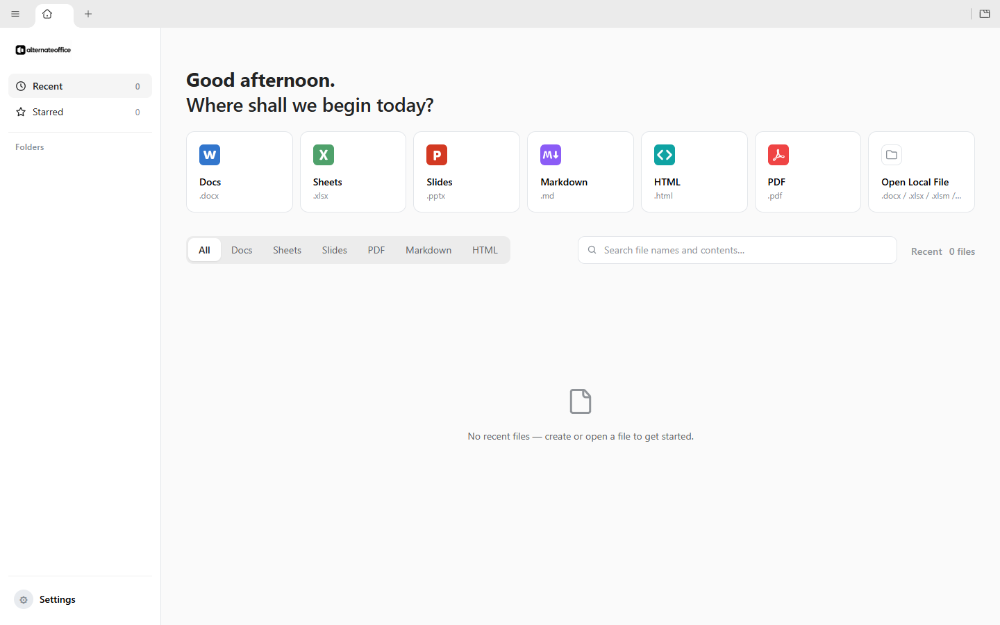
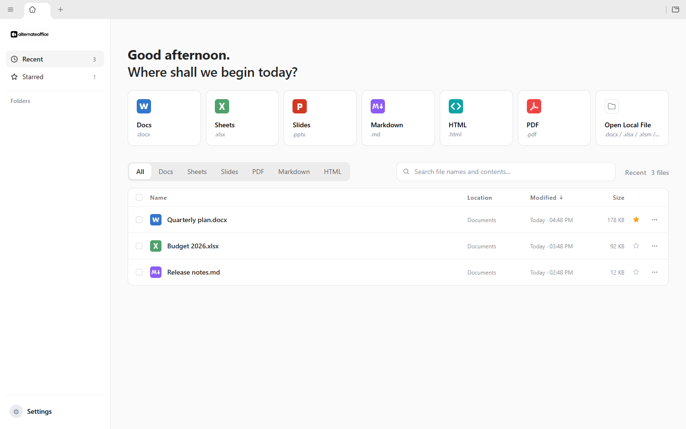
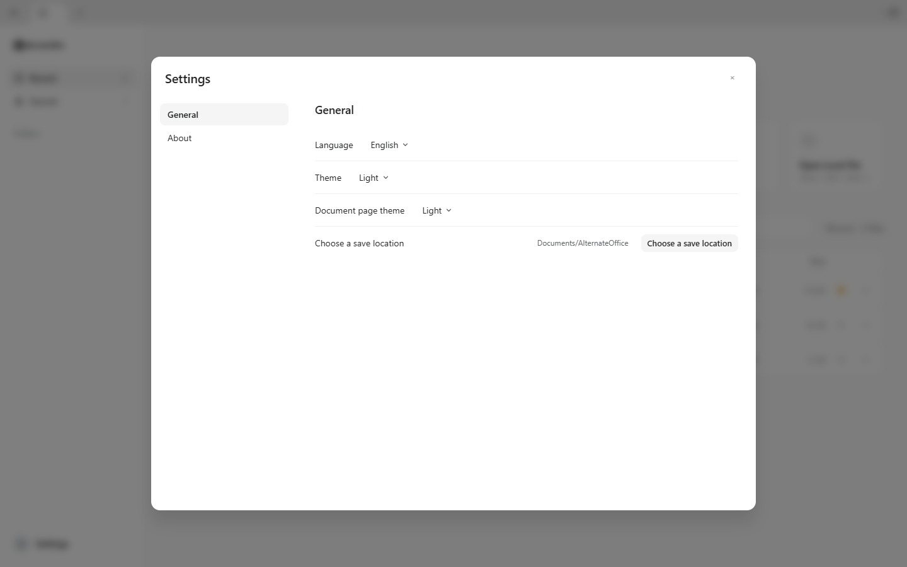

# AlternateOffice

AlternateOffice is a fork of [GenOffice](https://github.com/genspark-ai/genoffice).

This fork keeps the local Office editing foundation while leaving out the AI
features and integrations. It is intended for users who want a local-first
office suite without built-in AI functionality.

The project is licensed under the [Apache License 2.0](LICENSE).

## Screenshots

AlternateOffice brings local-first editing for documents, spreadsheets, slides,
Markdown, HTML, and PDFs into one workspace.

